Xを眺めているとコアメモリ製作キットがBOOTHで販売されているとの情報がありました。早速BOOTHのサイトに行ってdydt製作所さんから購入しました。
実際にコアメモリを編む体験ができて、しかもそれが動くことが確認できるという非常にディープなものでワクワクします。

* [dydt製作所 貴重な磁気コアメモリが作れる！かわいい16bit磁気コアメモリ製作キット](https://booth.pm/ja/items/8798449)

現在は予約注文になっているようです。

## 到着したコアメモリ製作キット

到着したコアメモリ製作キットです。しっかりとした梱包で、製作マニュアルも読みごたえがある内容でした。

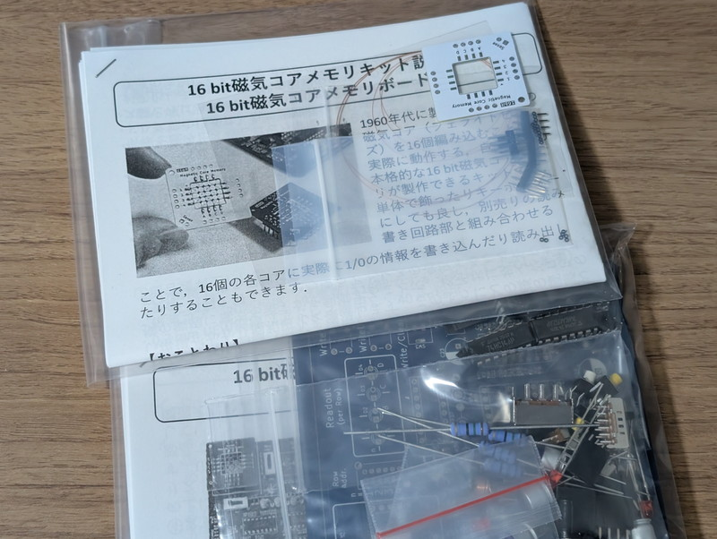

袋の中に見えるコアは非常に小さく、一般的な基板のランドの穴より小さいように見えます。予備が入っているとは言えこれは不注意で無くしてしまいそうです。
落ち着いて製作するのが良さそうなので、次の連休に組み立てることにしました。

## 縦横のアドレス線を編む

ピンセットとつまようじを用意して、製作マニュアルに従ってコアメモリを編んでいきます。0.2mmのUEW線で編むのですが、写真のようにコアの向きを互い違いにする必要があります。これがなかなか面倒です。つまようじを使いながらコアの向きを合わせていきます。

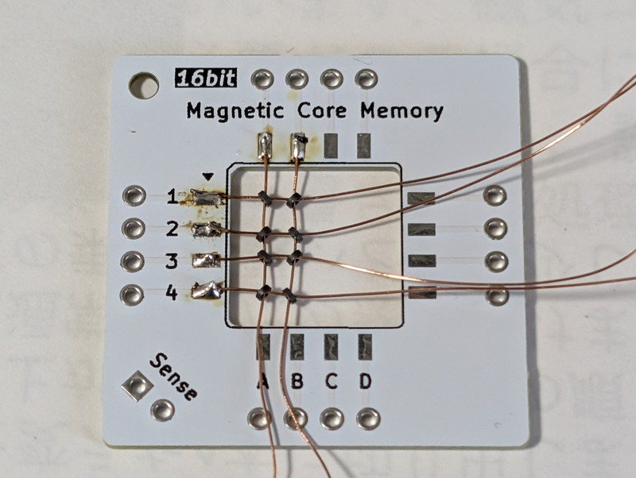

なんとかすべてのアドレス線を編むことができました。

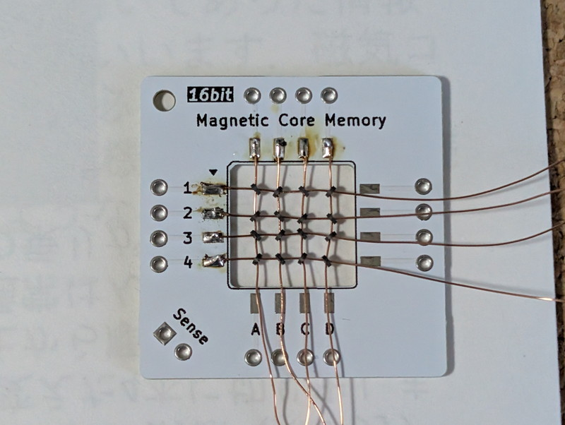

縦横のアドレス線の位置の微調整を行い、ハンダ付けして固定しました。

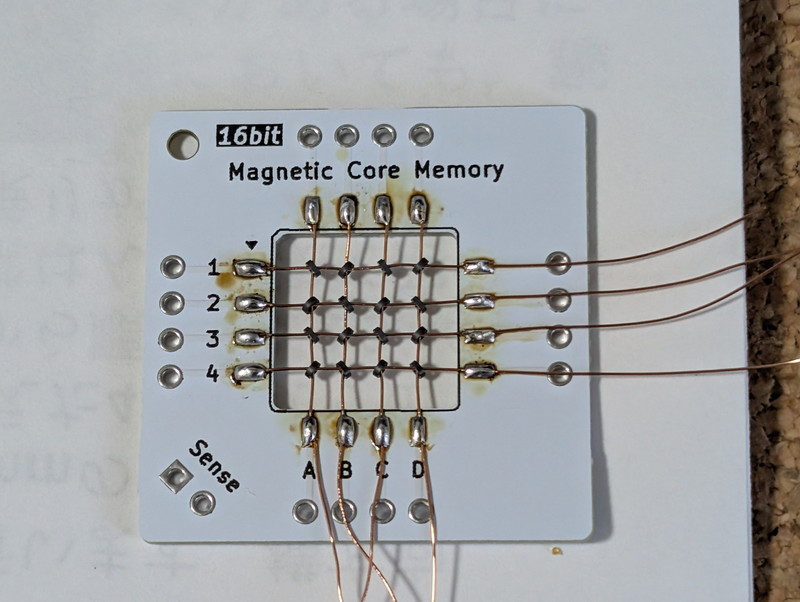

## 斜めのセンス線を編む

次は基板を裏返して、斜めのセンス線を編んでいきます。

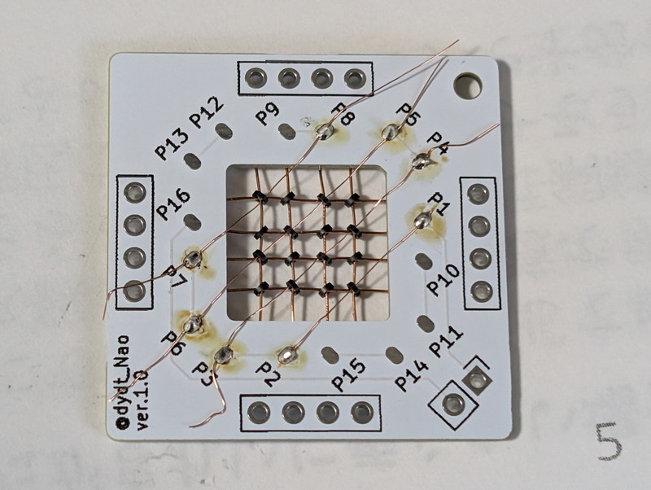

斜め方向に0.1mmのUEW線でコアを通していきます。これがなかなか通らない。特に3個のところは最後の1個がなかなか通りません。これはコアを少し押し上げながらなんとか隙間を作って通しました。

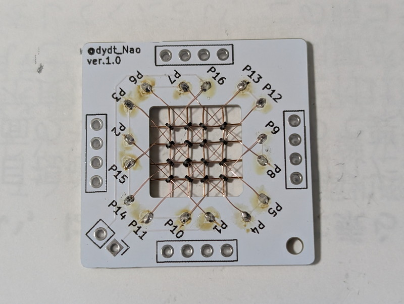

斜め方向のセンス線もすべて取り付けました。

## コアメモリボードが完成

完成したコアメモリユニットです。製作時間は90分ぐらいでしょうか。

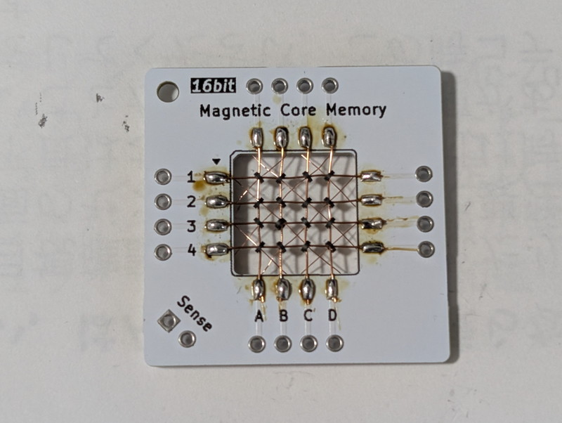

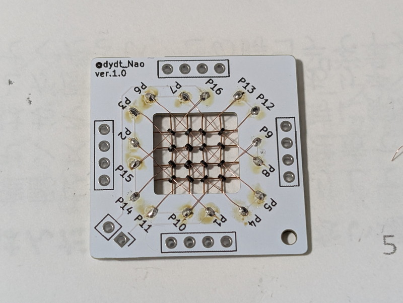

非常に良い経験になりました。

## コアメモリ読み書き基板を組み立てる

次はコアメモリ読み書き基板を組み立てます。

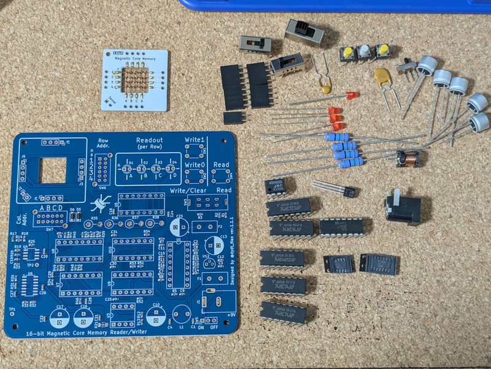

先ほどのコアメモリに比べればこちらの基板は一般的な基板でしたのでサクサク組み立てることができました。

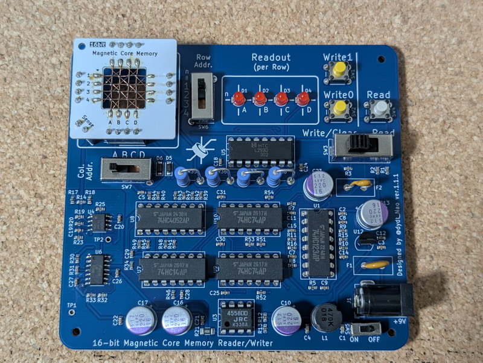

## 動作確認

目視確認で問題は無さそうでしたので、9V電源アダプタを接続して電源を投入しました。

マニュアルに書かれている操作方法の通りに操作し、A列の1行目に1を書き込むとLEDが一瞬点灯しました。もう一度書き込むとLEDは点灯しません。マニュアル通りの動作です。その後、ReadモードにしてReadボタンを押したところ、AのLEDが点灯しました。

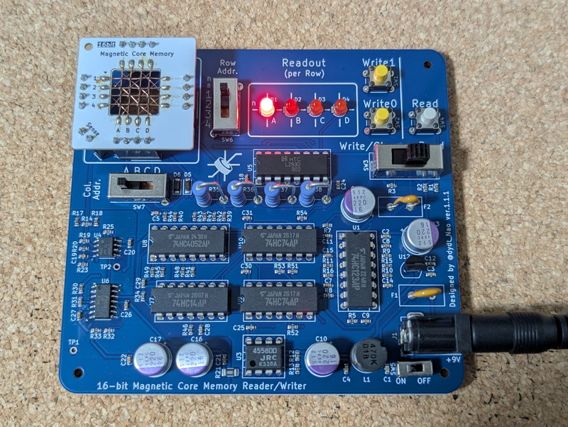

行、列のスライドスイッチを変えていきながら、Write1/Write0を適当に選んで書き込んだあとに、Readしていくと書き込んだ内容が読み出せました。確かに16bitメモリになっています。

## まとめ

使用されているパーツは一般的なものが多いですが、なかなか使う機会がない多段スライドスイッチや使用されているオペアンプが特殊なもので、この内容でこの価格で頒布しているのはすごいなと感じました。
今回このような素晴らしいキットを頒布していただいたdydt製作所にお礼を申し上げます。ありがとうございました。

## 追記

実は私もジャンクで入手したコアメモリ基板を持っています。

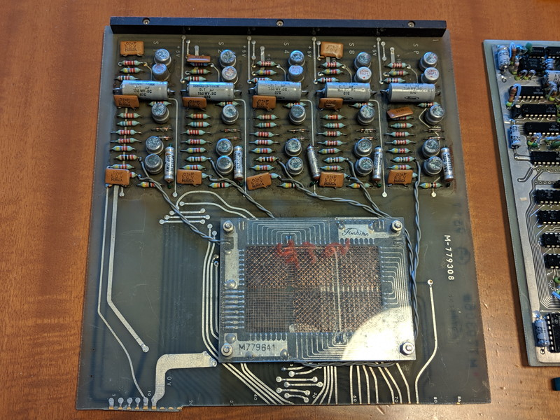

コアの部分を拡大すると綺麗な配線が見えます。どうやってこのように編んでいったのか興味がわきます。

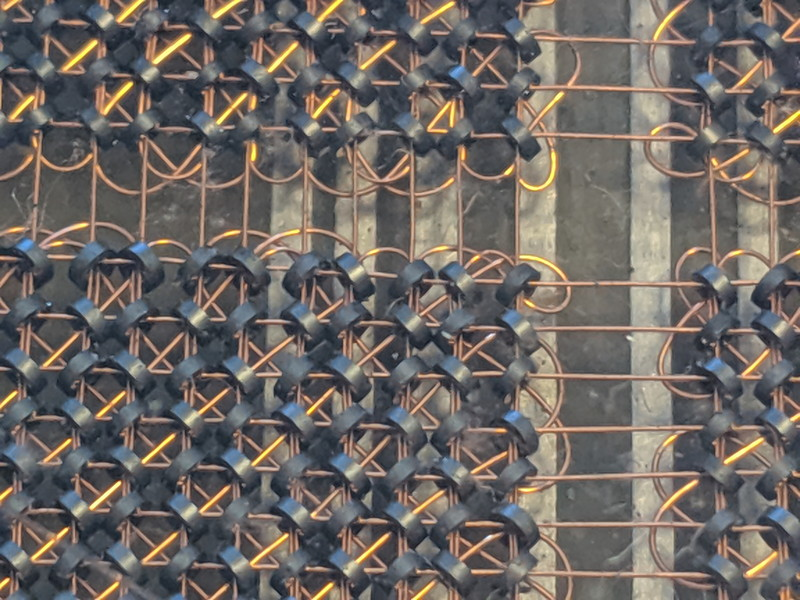

これを実際に動かせるかどうかはわかりませんが、何等かの方法で試してみたいと思います。
